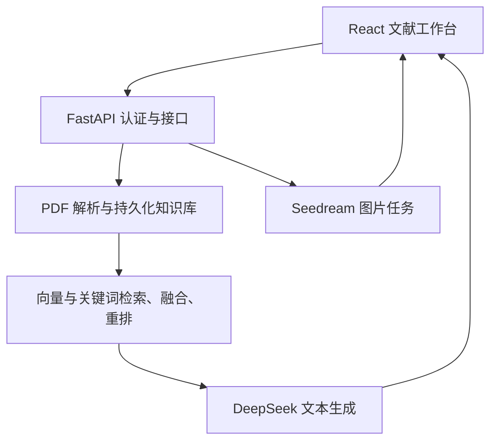

# 技术架构与实现

研迹 PaperTrail 采用 React 客户端与 FastAPI 服务端分离的结构。文献解析、检索、来源校验和数据访问由服务端执行；客户端承担文献选择、流式内容展示、PDF 阅读与配图交互。

## 系统组成



论文配图先通过检索和 DeepSeek 生成可编辑描述，客户端展示来源片段；用户确认后，才创建 Seedream 图片任务。

## 模块职责

| 模块 | 职责 |
|---|---|
| `backend/core.py` | PDF 解析、SQLite/Qdrant 持久化、BGE 模型加载、BM25、RRF 与重排 |
| `backend/generation.py` | DeepSeek 请求、流式事件解析、绘图描述与引用编号校验 |
| `backend/images.py` | Seedream 适配、图片任务队列、文件保存及用户隔离 |
| `backend/main.py` | 项目令牌认证、请求校验、FastAPI 路由与服务生命周期 |
| `frontend/src/App.tsx` | 文献管理、问答状态、来源证据与配图入口 |
| `frontend/src/ImageStudio.tsx` | 草稿编辑、图片任务状态、历史、预览和下载 |
| `frontend/src/api.ts` | 带令牌请求、NDJSON 流处理、超时与错误转换 |

## 文献入库

PyMuPDF 按 PDF 物理页提取文本，分块在单页内部进行，保留文件名与页码。默认块长为 700 个字符，相邻块重叠 100 个字符。文档以 UUID 标识，以文件 SHA-256 在同一用户范围内识别重复上传。

SQLite 保存文档元数据和原文片段，本地 Qdrant 保存向量，文件系统保存原始 PDF。用户标识参与查询与权限校验，删除文档时同步移除原件、片段及对应向量。

单篇文件上限为 30 MiB、500 页、10000 个分块。没有可提取文本的 PDF 返回处理提示；系统不会将扫描图片当作已解析文本。

## 混合检索与引用问答

1. 根据访问令牌与文献选择确定检索范围。
2. BGE 计算问题向量并召回语义相近的片段；BM25 对分词后的文本进行关键词检索。
3. RRF 合并两路候选排序，BGE Reranker 对问题与候选片段进行重排。
4. 将选中的原文片段构造成带编号的证据，交由 DeepSeek 生成回答。
5. 服务端检查回答引用的编号是否存在于本次证据集合，再返回引用片段与 PDF 页码。

默认 Embedding 为 `BAAI/bge-small-zh-v1.5`，Reranker 为 `BAAI/bge-reranker-base`，均按需加载。问答接口默认选择最多 10 条证据，`top_k` 可配置为 1–30。没有检索证据时不调用文本模型。

模型提示词约束回答以证据为依据，并将文献文本视为资料而非可执行指令。引用编号有效仅表示来源编号合法；系统未实现对所有论断的自动事实验证。当前检索方案属于现有方法的工程集成，尚未提供相对单一检索基线的量化性能结论。

## 流式回答与异常状态

后端读取模型平台的流式响应，再通过 NDJSON 向客户端发送 `progress`、`delta`、`done` 或 `error` 事件。进度信息不包含模型内部思考正文；`delta` 阶段的内容是未完成引用校验的草稿。

回答达到长度上限或模型连接中断时，已有正文在完成引用编号检查后可以作为不完整结果保留，并携带 `finish_reason`、`incomplete` 和提示信息。未知引用编号会触发错误。浏览器未收到 `done` 时，不将草稿标记为已完成回答。

文本生成的输出预算与超时由后端配置控制；配图描述使用独立预算。模型调用失败后不会自动创建第二次收费请求。详细协议见 [API 接口](API.md)。

## 图片任务与存储

Seedream 根据确认后的描述生成单张 2K 图片。响应使用 Base64 图片数据，服务端校验文件格式和大小后保存；客户端通过带认证的文件接口获取预览及下载内容。

任务状态为 `queued`、`running`、`succeeded` 和 `failed`，并记录请求编号、模型、时间、错误与来源快照。同一用户、同一请求编号和相同参数复用已有任务；使用相同编号但改变参数会被拒绝。

图片队列由单个工作线程处理，每个用户最多保留 1 个未完成任务，服务端最多接受 8 个未完成任务。状态轮询读取本地记录，不会再次调用图片模型。重启时遗留的未完成任务被标记为失败，系统不自动重新生成。

图片列表展示最近 30 条任务，这不是持久化存储上限。当前没有图片自动过期清理或删除界面；删除来源论文不会自动删除已有图片及其来源快照。

## 运行与数据边界

服务采用单后端进程，本地 Qdrant 数据目录不能由多个实例同时打开。备份应在停止后端后复制整个数据目录，避免只备份向量或只备份 PDF 造成数据不一致。

项目访问令牌与模型平台密钥分开管理，模型密钥保存在服务端配置中。当前没有完整账号注册、生产级用量配额或分布式任务调度；公网部署与高并发容量未纳入现有验证结果。安装、数据迁移与故障处理见 [安装与使用](USAGE.md)。

## 代码规范与质量检查

源文件采用 UTF-8、LF 换行和文件末尾换行；Python 使用 4 空格缩进，TypeScript、JSON 与样式文件使用 2 空格。`.editorconfig` 约束编辑器行为，`.gitattributes` 统一 Git 中文本文件的换行方式。

Python 命名采用函数/变量 `snake_case`、类 `PascalCase`、常量 `UPPER_SNAKE_CASE`。Ruff 配置在 `pyproject.toml`，检查导入顺序、未使用符号与基础错误，并以 100 列为目标格式化代码。关键注释解释约束和原因，例如引用不得跨页、用户隔离边界及收费请求不自动重试，避免仅复述语句。

TypeScript 启用 `strict`；组件和类型使用 `PascalCase`，函数及变量使用 `camelCase`。`npm run build` 先执行 TypeScript 类型检查再打包。新增功能沿用 `api.ts` 请求封装及已有错误类型，不将模型平台密钥写入前端。

项目根目录执行 Python 检查：

```powershell
.\.venv\Scripts\python.exe -m pip install -r requirements-dev.txt
.\.venv\Scripts\python.exe -m ruff check .
.\.venv\Scripts\python.exe -m ruff format --check .
.\.venv\Scripts\python.exe -m pytest -q
```

需要整理 Python 格式时执行 `python -m ruff format .`，然后审查差异并重跑检查。公共测试资源位于 `tests/helpers.py`，知识库 fixture 由 `tests/conftest.py` 提供；测试模块不互相导入。

前端检查：

```powershell
cd frontend
npm ci
npm test
npm run build
```

`.github/workflows/ci.yml` 对后端配置了 Python 3.12 的 Linux/Windows 检查，对前端配置了 Node.js 24 的测试和构建。工作流使用模拟模型与临时目录，不需要平台密钥或真实 BGE 权重。云端是否执行成功以对应提交的 Actions 记录为准。

## 协作与版本记录

功能变更通过独立分支和拉取请求审查，提交说明描述具体功能、修复或文档变化。仓库保留既有提交与合并历史；使用保留提交的合并方式，不通过重新初始化仓库、改写作者日期或压缩已有历史来替代开发记录。

仓库仅跟踪源码、测试、说明和配置模板。真实 `.env`、论文及向量数据、模型权重、`.venv`、`node_modules`、构建产物和 `.idea` 本地设置由 `.gitignore` 排除。团队成员各自配置解释器与访问令牌，用户数据按 [数据迁移与备份](USAGE.md#7-数据迁移与备份) 独立迁移。
